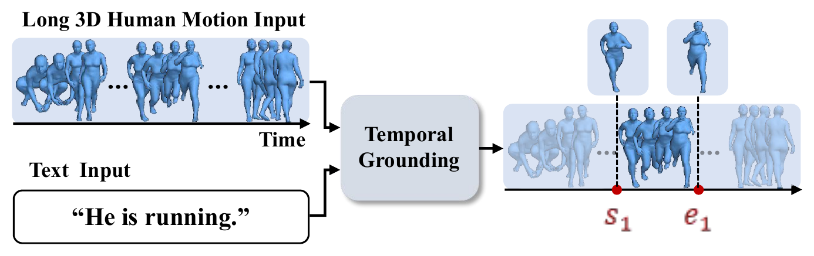
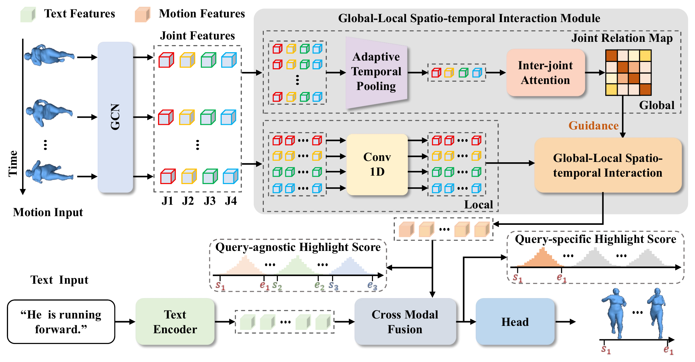
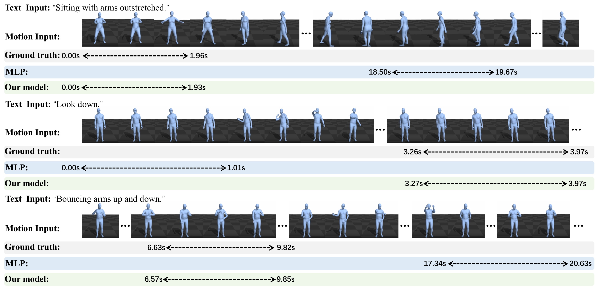

# DHiST: BABEL and HumanML3D

Official implementation of **DHiST: Dual-Highlight Spatio-Temporal Learning
for Temporal Sentence Grounding in 3D Human Motions**.

<p align="center">
  
</p>

<p align="center"><em>Figure 1. Given a language query and a long, untrimmed 3D human motion, DHiST localizes the corresponding temporal segment.</em></p>

Given a long, untrimmed 3D human motion and a natural-language query, DHiST
localizes the temporal segment that matches the query.

This release provides BABEL training code and prediction-only evaluation for
BABEL and HumanML3D, with lightweight LoRA checkpoints and audited result
metadata. HumanML3D is released for checkpoint inference and evaluation only;
its training entry point and training recipe are not provided. Datasets, motion features,
generated outputs, machine paths, and development history are excluded.

## Method

<p align="center">
  
</p>

<p align="center"><em>Figure 2. DHiST combines query-agnostic highlighting, global-local spatio-temporal interaction, and query-specific refinement in a coarse-to-fine grounding pipeline.</em></p>

DHiST follows a coarse-to-fine grounding pipeline:

- **Query-Agnostic Highlight Score (QAHS)** predicts motion-level saliency and
  start/end boundary priors before motion-language interaction.
- **Global-Local Spatio-Temporal Interaction Module (GL-STIM)** combines
  sequence-level inter-joint relations with short-range temporal dynamics.
- **Query-Specific Highlight Score (QSHS)** refines the fused representation
  according to the input query before final boundary prediction.

## Reproduced single-checkpoint results

Both release checkpoints are evaluated by the same prediction-only entry
point. They are single models: no seed, checkpoint, or prediction ensemble is
used.

| Dataset | R1@0.1 | R1@0.3 | R1@0.5 | R1@0.7 | R1@0.9 | mIoU |
|---|---:|---:|---:|---:|---:|---:|
| BABEL | 51.9542 | 45.2408 | 38.0839 | 29.6690 | 13.0040 | **35.4063** |
| HumanML3D | 74.4207 | 63.7500 | 51.6768 | 41.1280 | 15.5793 | **49.0722** |

Complete R1/R5/mIoU records and protocol metadata are stored under
[`artifacts/babel_35_3`](artifacts/babel_35_3) and
[`artifacts/humanml3d_49_0`](artifacts/humanml3d_49_0).

Protocol disclosure: BABEL uses this project's validation-selected protocol.
The HumanML3D result is a previously exposed official-test diagnostic selected
from the Round19 study. Neither number should be described as a new blind or
independent test result. The HumanML3D row is the traceable released
single checkpoint with mIoU 49.07; it is not the distinct paper row
50.80/41.58/16.79/49.07.

## Qualitative results

<p align="center">
  
</p>

<p align="center"><em>Figure 3. Qualitative comparison between DHiST and MLP on BABEL. The green interval denotes the ground-truth segment.</em></p>

DHiST better separates the queried interval from temporally distant regions
with similar motion and more accurately localizes short actions such as
"Look down."

## Checkpoints

The compact checkpoints contain every trained DHiST tensor, all LoRA tensors,
and the trained text projection. The unchanged frozen `roberta-base` backbone
is reconstructed during initialization and deliberately omitted.

| Dataset | Release | Asset | Epoch | SHA-256 |
|---|---|---|---:|---|
| BABEL | [`babel-v1.0`](https://github.com/shisyy/DHiST/releases/tag/babel-v1.0) | `dhist_babel_35_3_epoch94.ckpt.pkl` | 94 | `e014dcc8ec165bb9b0b2aa15d834e2fceddbf37c1fcd185c5de404e1bb233f83` |
| HumanML3D | [`humanml3d-v1.0`](https://github.com/shisyy/DHiST/releases/tag/humanml3d-v1.0) | `dhist_humanml3d_49_0_seed123_e15.ckpt.pkl` | 16 | `ba4fd38e3498547fdf13063539a6be25a060ddd8583e7a41c5aa872b034991c7` |

Download and verify either asset:

```bash
python scripts/download_checkpoint.py --dataset babel
python scripts/download_checkpoint.py --dataset humanml3d
```

## Prediction-only inference

The public evaluation path does not feed annotated boundaries to the model or
decoder:

- all six label-like network inputs are created as zeros;
- annotation-derived segment-prior caches are not read during evaluation;
- label corruption and dropout are disabled;
- the decoder consumes predicted LP start/end logits and predicted highlight
  scores only;
- ground-truth timestamps are used only after prediction, by the metric
  accumulator.

For both checkpoints, replacing all six label inputs by zeros or random values
produces an audited maximum absolute difference of `0.0` in every prediction
output. See each artifact directory's `label_invariance_audit.json`.

## Installation

The audited environment used Python 3.9.23, PyTorch 2.5.0+cu118,
Transformers 4.38.0, and PEFT 0.10.0.

```bash
conda create -n dhist python=3.9 -y
conda activate dhist
# Install a PyTorch build appropriate for your CUDA version first.
pip install -r requirements.txt

mkdir -p deps
git lfs install
git clone https://huggingface.co/roberta-base deps/roberta-base
git clone https://huggingface.co/sentence-transformers/all-mpnet-base-v2 \
  deps/all-mpnet-base-v2
```

## Data preparation

BABEL, HumanML3D, and AMASS data are not redistributed. Obtain them from their
official sources and accept their licenses. Follow
[`datasets/README.md`](datasets/README.md) for the expected annotations,
splits, and Guo motion-feature layout.

## Evaluation

After preparing a dataset and downloading its checkpoint:

```bash
python eval_predonly.py --dataset babel \
  --checkpoint artifacts/babel_35_3/ckpt.pkl \
  --output outputs/babel_35_3_eval

python eval_predonly.py --dataset humanml3d \
  --checkpoint artifacts/humanml3d_49_0/ckpt.pkl \
  --output outputs/humanml3d_49_0_eval
```

The evaluator writes `summary.json`, predictions, logs, and a fresh
label-invariance audit. The compatibility commands `python eval.py` and
`python eval_humanml3d_predonly.py` select BABEL and HumanML3D respectively.

## BABEL training

BABEL's released setup uses seed 42, 100 epochs, batch size 64, AdamW,
learning rate `2e-4`, decay step 50, `alpha=0.8`, and `beta=0.1`:

```bash
bash run_babel_lora.sh 0
```

Training is stochastic, so a new run is not expected to reproduce every
decimal. Exact metric reproduction is provided by the released checkpoint,
configuration, deterministic prediction-only evaluator, and SHA-256 checks.

For HumanML3D, use the checkpoint download and evaluation commands above.
`artifacts/humanml3d_49_0/config.yaml` is an evaluation configuration; it
contains no optimizer or training schedule. Shared model-construction fields
are retained for compatibility with the released weights.

## License and acknowledgments

Code is released under the Apache License 2.0. This implementation builds on
the open-source MLP codebase and includes components inspired by VSLNet, LGI,
HumanML3D, TMR, and AMASS-Annotation-Unifier. Follow the licenses and citation
requirements of BABEL, HumanML3D, AMASS, RoBERTa, MPNet, and the upstream
projects.
